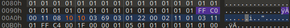

# JPEG 头修复

> **所属分类**：Misc ｜ **难度参考**：简单
> **适用题型**：JPEG 打不开/缺头，或画面像被"切掉"下半截，隐藏内容在画面底部。

## 一、知识点原理讲解

### JPEG 关键标记
JPEG 是按段（segment）组织的，重要标记：

| 标记 | 名称 | 说明 |
| --- | --- | --- |
| `FF D8` | SOI（图像开始） | 文件头，其后常跟 APP0 |
| `FF E0` | APP0 | 紧跟 `4A 46 49 46`（"JFIF"）即 JFIF 头 |
| `FF C0` / `FF C2` | SOF0 / SOF2 | 帧开始，内含**高度/宽度**字段 |
| `FF D9` | EOI（图像结束） | 文件尾 |

### 两种常见破坏
1. **头部被削**：标准开头 `FF D8 FF E0` 被删，文件直接以 `4A 46 49 46`（JFIF）开头，查看器不认。手动在最前面补回 `FF D8 FF E0` 即可。
2. **高度被改小**：SOF0 帧头里的"高度"字段（`FF C0` 之后第 4~5 字节，2 字节大端）被改小，解码时只画了上半部分，下半截内容被藏起来。把这个高度改大，底部隐藏内容就显露出来。

### SOF0 字段布局
`FF C0` 之后：长度(2) + 精度(1) + **高度(2,大端)** + **宽度(2,大端)** + 组件数(1)……

## 二、通用解题思路 / 套路

```
JPEG 打不开
→ file / 十六进制看开头：若直接是 JFIF 或数据
→ 最前面补 FF D8 FF E0（SOI + APP0）再打开
画面像被截断、底部空白/缺失
→ 十六进制搜 FF C0（SOF0）
→ 其后第 4~5 字节为高度(2字节大端)，尝试改大
→ 保存后重新打开，露出隐藏下半部分
```

易错点：
- 高度在 **SOF0(FF C0)** 之后，不是文件开头；
- 宽度/高度都是大端 2 字节；
- 补头只补 `FF D8 FF E0`，不要乱加其它字节。

## 三、工具使用

| 工具 | 安装 | 常用命令 / 参数 | 输出解读 |
| --- | --- | --- | --- |
| 010Editor / HxD | 官网 | 搜 `FF D8`、`FF C0` | 手工补头 / 改高度字段 |
| file | Kali 自带 | `file x.jpg` | 确认是否缺头 |



## 四、实战例题

### 例题 1：解密出的 JPEG 缺 SOI 头且高度被改小
- 题型特征：从加密压缩包解出的文件以 `JFIF` 字样开头却打不开；勉强补头后画面只显示上半截。
- 解题思路：先发现开头缺 `FF D8 FF E0`，手动补回 SOI+APP0；能打开后发现画面被截断，在十六进制编辑器里搜 `FF C0`，把其后的高度字段（2 字节大端）改大，保存重开即露出被藏的下半部分内容。
- 关键工具/脚本：`../assets/images/JPEG头修复/sof0_height.png`（在 SOF0 处定位并修改高度字段的示意）。
- 结果：露出的隐藏内容即为 flag。
