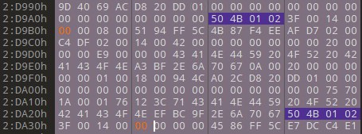
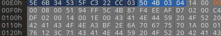

# ZIP 伪加密与修复

> **所属分类**：Misc
> **适用题型**：解压弹密码框，但题目暗示"没真加密"；文件很小却要密码

## 一、知识点

### ZIP 两处描述一个条目
ZIP 里每个文件条目有两处记录它的元信息：

- **本地文件头**：签名 `50 4B 03 04`
- **中央目录记录**：签名 `50 4B 01 02`

紧跟签名之后的第 3~4 字节是 **通用标志位（General Purpose Flag）**，2 字节小端
关键位：

| bit | 含义 | 真加密 | 伪加密样本 |
| --- | --- | --- | --- |
| bit0 | 加密标记 | 1 | 1（伪装成加密） |
| bit3 | 存在数据描述符 | 视情况 | 1（必须保留） |

### 伪加密
解压软件一看通用标志位 bit0=1 就认为"加密了"，弹出密码框；
但文件**其实没有用口令真加密**，是 ZIP 伪加密

### 修复
本类样本标志低字节常为 `0x09`（二进制 `1001`：bit0=1 假加密，bit3=1 有数据描述符）

- **错误做法**：整字节改 `0x00`——会把 bit3 也清掉，解压时因找不到数据描述符而报错
- **正确做法**：只清 bit0，`0x09(1001) → 0x08(1000)`，保留 bit3

本地文件头与中央目录**两处**标志位是否都要改：

```text
50 4B 03 04 14 00 09 00 ...      ← 本地文件头，把 09 改成 08
50 4B 01 02 ... 09 00 ...        ← 中央目录，把这里的 09 也改成 08
```

## 二、通用思路

```
解压要密码，但题目有暗示
→ 010Editor 打开，搜 50 4B 03 04（本地头）与 50 4B 01 02（中央目录）
→ 两处通用标志位低字节均为 09
→ 只清 bit0：09 → 08  注意保留 bit3 数据描述符
→ 保存后正常解压
```

- 只改本地头不改中央目录会两处不一致，仍报错；
- 别把整标志字节清 0，会误删其他bit的数据描述符
- 判断真/伪加密：真加密文件数据是乱的、伪加密改完标志位就能直接明文解压

## 三、工具使用

| 工具 | 安装 | 常用命令 / 参数 | 输出解读 |
| --- | --- | --- | --- |
| 010Editor / HxD | 官网 | 搜 `504B0304` / `504B0102`，改其后标志位 | 手工清 bit0 |
| zipinfo | Kali 自带 | `zipinfo -v x.zip` | 看 Encrypted 标记是否可疑 |





## 四、实战

### 解压要密码，题目有暗示的ZIP
- 思路：
010Editor 搜本地头 `504B0304` 与中央目录 `504B0102`，两处通用标志位低字节都是 `09`
只清 bit0 改成 `08`保留 bit3 ，保存后可正常解压取出里面的文本
