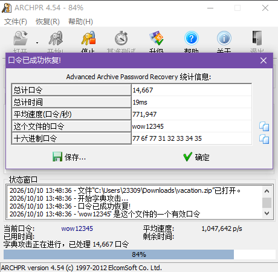
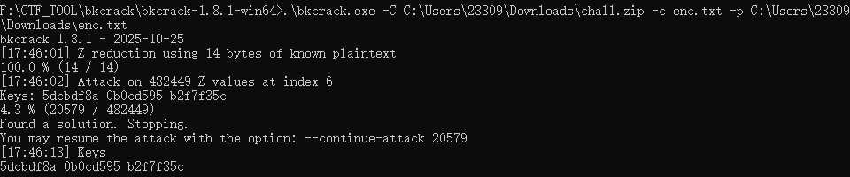

# ZIP 口令爆破与已知明文攻击

> **所属分类**：Misc ｜ **难度参考**：偏难
> **适用题型**：多层 ZipCrypto 加密包；或包里有一个你已知内容的小文件。

## 一、知识点原理讲解

### 1. 字典/暴力爆破
传统 ZIP（ZipCrypto）口令未知时，可用字典或暴力枚举。CTF 中口令通常较弱（数字+常见词），用 ARCHPR、john、hashcat 加载字典命中即可。

### 2. ZipCrypto 的致命弱点——已知明文攻击（bkcrack）
ZipCrypto 流加密有结构性缺陷：**只要知道同一个压缩包里任意一个文件的 ≥12 字节明文**（且与压缩包里是同一文件），就能还原出内部三把密钥（k1/k2/k3），进而解开同包内所有其他加密文件，**无需知道口令本身**。

这要求：
- 该文件在压缩包里是 ZipCrypto 加密；
- 你掌握它的足够长明文（哪怕只有十几字节）；
- 知道其 CRC 与大小更佳。

### 3. 密钥复用
bkcrack 先从"已知明文文件"还原三把密钥，再用这三把密钥**解密同包内其他加密文件**，与口令无关。

## 二、通用解题思路 / 套路

```
外层 ZIP 加密
→ 先用 ARCHPR/字典爆破外层口令
→ 解开后发现内层还是 ZipCrypto，且有一个已知内容的小文件
→ bkcrack 用已知明文攻击，还原 k1 k2 k3
→ 用三把密钥直接解密同包内目标文件
```

易错点：
- 已知明文文件必须与压缩包里是**同一文件**、≥12 字节；
- 不要死磕爆破内层口令——有已知明文就上 bkcrack；
- 口令也可能藏在别处（如流量自定义请求头），先别盲目爆破。

## 三、工具使用

| 工具 | 安装 | 常用命令 / 参数 | 输出解读 |
| --- | --- | --- | --- |
| ARCHPR | 官网 Windows 工具 | 加载 zip → 字典/掩码攻击 | "口令已成功恢复" |
| bkcrack | 官网 release | `bkcrack -C 包.zip -c 包内文件 -p 明文文件` | 输出 `Keys: k1 k2 k3` |
| bkcrack 解密 | 同上 | `bkcrack -C 包.zip -c 目标 -k k1 k2 k3 -d out` | 解密出目标文件 |

```bash
# 用已知明文 enc.txt 攻击，得到内部三把密钥
bkcrack.exe -C chall.zip -c enc.txt -p enc.txt
# 用三把密钥解密同包内的目标文件
bkcrack.exe -C chall.zip -c ohno.jpg -k <k1> <k2> <k3> -d ohno.jpg
```





## 四、实战例题

### 例题 1：双层 ZipCrypto + 一个已知内容小文件
- 题型特征：外层 ZIP 加密，解开后内层仍是 ZipCrypto，但其中有一个内容已知的小文本。
- 解题思路：先用 ARCHPR 字典爆破出外层口令，解开得到"已知明文小文件"+内层加密包；运行 bkcrack 用已知明文还原三把内部密钥，再用密钥直接解密内层的目标图片文件（口令全程未知）。
- 关键工具/脚本：`../assets/images/ZIP口令爆破与已知明文/archpr_dict.png`（字典爆破外层口令成功）、`../assets/images/ZIP口令爆破与已知明文/bkcrack_keys.png`（已知明文攻击得到 k1/k2/k3）。
- 结果：解出目标图片并继续修复。

### 例题 2：口令藏在流量自定义请求头里
- 题型特征：pcap 流量中 HTTP 请求带一个非标准头，值像 base64。
- 解题思路：过滤 `http` 逐行看请求头，凡"非标准命名 + 像 base64"的都解一下；base64 解码即得压缩包口令，直接解压，无需爆破。
- 关键工具/脚本：Wireshark 过滤 `http`、Base64 解码。
- 结果：用解出口令解压图片后做下游隐写。
