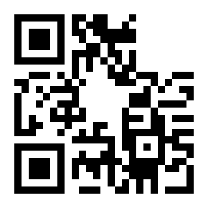

# 二维码修复

> **所属分类**：Misc ｜ **难度参考**：简单
> **适用题型**：扫不出来的残缺二维码；缺角、缺定位符、被污损。

## 一、知识点

### QR 码定位符（Finder Pattern）
标准 QR 码三个角各有一个 7×7 的"回"字形黑白方块定位符。扫码器靠这三个定位符来定位、纠偏、确定行列数。**缺了某个定位符，扫码器就无法对齐，直接识别失败。**

### 常见残缺
- 缺角定位符
- 局部污损/遮挡
- 尺寸过小、模糊

### 修复
对照另外两个完整角的样式，用图像编辑工具（PS / 画图 / 在线工具）补一个同样的定位符到缺失角
再用扫码器
补全后 QR 的纠错码（Reed-Solomon）能帮助读出数据

## 二、通用解题思路 / 套路

```
二维码扫不出来
→ 先肉眼看三个角是否都有回字形定位符
→ 缺哪个角就按另两角样式补哪个
→ 再用扫码器 / zbarimg 识别
→ 读出字符串（常是 flag 的一段）
```

易错点：
- 补的定位符必须是 7×7 标准回字，别画歪；
- 若补完仍识别失败，检查是否行列数被遮挡；
- QR 读出的常是多段 flag 之一，注意和其它段拼接。

## 三、工具使用

| 工具 | 安装 | 常用命令 / 参数 | 输出解读 |
| --- | --- | --- | --- |
| zbarimg | Kali 自带 | `zbarimg qr.png` | 直接输出扫码内容 |
| 图像编辑 | PS/画图 | 按另两角补回字形定位符 | 修复残缺角 |



## 四、实战例题

### 例题 1：缺右下角定位符、扫不出的二维码
- 题型特征：一张 QR 码，扫码器完全识别失败；与其它载体（图片尾、音频）组合出题。
- 解题思路：肉眼发现右下角缺了"回"字形定位符，按左上、右上两角的样式补出标准 7×7 回字定位符，再用扫码器识别，读出第一段字符串
- 关键工具/脚本：`../assets/images/二维码修复/damaged_qr.png`
- 结果：补全后能识别出一个 flag 片段
