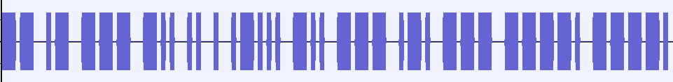

# 音频频谱隐写

> **所属分类**：Misc ｜ **难度参考**：简单
> **适用题型**：一段 WAV/音频听不出内容；题面带"广播/信号/频谱/听"等词。

## 一、知识点原理讲解

### 原理
普通波形视图只能看到声音的时间-振幅，隐藏内容往往藏在**时频域（频谱图 Spectrogram）**。把音频切到频谱视图，纵轴是频率、横轴是时间，亮暗代表该时频点的能量。隐写者直接用高亮像素在时频域"画"出文字，或用时长不同的音表示摩斯点划——时域波形上完全听不出来。

### 两种常见玩法
1. **频谱里直接画字**：在 Audacity 切到 Spectrogram 视图放大，能看到亮起来的明文字符。
2. **频谱里的摩斯**：长短不一的音条，短条=点（`.`）、长条=划（`-`），按摩斯表解码。

> 类比工具：Sonic Visualiser、DeepSound。

## 二、通用解题思路 / 套路

```
音频听不出内容
→ Audacity 打开，右键轨道切到 Spectrogram 频谱图视图
→ 放大时频图
→ 看到亮显的明文字符 → 直接读
→ 或看到长短音条 → 短=点、长=划，按摩斯表解码
→ 读出字符串（可能是中间口令或结果本身）
```

易错点：
- 必须切到 Spectrogram 视图并放大，普通波形看不出字；
- 摩斯要区分"点划间距"和"字母间距"；
- 频谱里读出的可能只是**中间口令**，别当最终 flag。

## 三、工具使用

| 工具 | 安装 | 常用操作 | 输出解读 |
| --- | --- | --- | --- |
| Audacity | 官网 | 打开 wav → 轨道下拉选 Spectrogram | 时频图中读字/读摩斯 |
| Sonic Visualiser | 官网 | 加 Spectrogram 层 | 同上 |




## 四、实战例题

### 例题 1：广播式音频，频谱里藏摩斯密码
- 题型特征：给一段音频，题面暗示"广播/深夜信号"。
- 解题思路：把音频拖进 Audacity 切到频谱图视图，看到时长不一的音条：短条=点、长条=划，按间距区分字母，对照摩斯表逐字母解码出字符串。
- 关键工具/脚本：`../assets/images/音频频谱隐写/spectrogram.png`（频谱图中长短音条即摩斯点划）。
- 结果：解出字符串即为结果。

### 例题 2：头像尾部拼的 WAV，频谱里藏解压口令
- 题型特征：从 PNG 尾部分离出一段 WAV，需给一个加密压缩包找口令。
- 解题思路：Audacity 打开分离出的 wav，切频谱图视图，看到用高亮像素"画"出的明文字符串，读出即下层 `secret.zip` 的解压口令（中间线索，非最终 flag）。
- 关键工具/脚本：`../assets/images/音频频谱隐写/spectrogram_shaoshangxian.png`（频谱图中亮显的字符）。
- 结果：读出的字符串作为压缩包口令。
